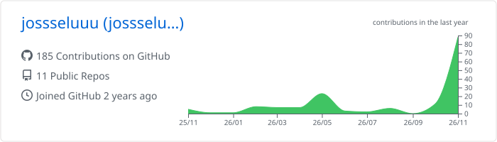
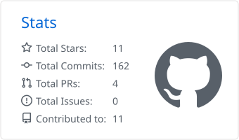
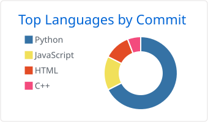

<picture>
  <source media="(prefers-color-scheme: dark)" srcset="assets/banner-dark.png">
  
</picture>

# José Luis López

**Computer Science & Engineering student · Granada, Spain** 
Air traffic control bots · image steganography · multi-agent systems · technical writing

 

**English** · [Español](#es)

---

Most of what's on this profile started with a question I couldn't let go of. How does a controller keep dozens of aircraft apart without anyone noticing? How much can you hide inside a photo before the photo gives you away? What is a phone actually saying over the air while it sits on the table?

I answer those questions by building something, measuring how well it works and writing down what I learned along the way.

## About me

I'm a final-year **Computer Science & Engineering** student at the **Universidad de Granada**. I spent a full academic year at the **University of Montana** on an exchange programme and worked in the United States during that time, which taught me a lot about landing in an unfamiliar place and figuring things out quickly.

The areas I keep coming back to are backend systems, applied AI, security and optimisation, and above all the places where they overlap. A few habits show up in almost everything I build:

- **I write the design down first.** Specifications, requirements and architecture decision records (ADRs) come before the code, especially in [CompanyAgentsHQ](https://github.com/jossseluuu/CompanyAgentsHQ) and [I-CPU](https://github.com/jossseluuu/I-CPU).
- **I want numbers, not impressions.** I-CPU runs steganalysis against its own output; the openScope bots are scored on separation losses and runway throughput.
- **Safety is part of the design.** Approval steps, audit logs, safety shields and strict content policies are there from the first commit, not added later.
- **I like explaining things.** I write technical content in English and Spanish, aiming for something a beginner can follow and an expert won't wince at.

---

## Selected projects

| | Project | In one line | Where it stands |
|:-:|---|---|---|
| 🛫 | **[openScope](#openscope)** | AI air traffic controllers on top of an open-source ATC simulator | Bot A working · Bot B implemented, not yet trained |
| 🔐 | **[I-CPU](#i-cpu)** | Encrypted image steganography that measures how detectable it is | v2.0.0 released |
| 📡 | **[HowThingsTalk](#howthingstalk)** | Bilingual explanations of how everyday devices work | Ongoing writing project |
| 🏢 | **[CompanyAgentsHQ](#companyagentshq)** | A company of AI agents you manage from an isometric office | In development |
| 🚦 | **[ZeroTrace](#zerotrace)** | A daily bilingual cybersecurity newsletter, one concept per edition | Ongoing · daily editions |

 

### 🛫 [openScope](https://github.com/jossseluuu/openScope) · AI air traffic controllers

Fork of the open-source <a href="https://github.com/openscope/openscope">openScope ATC simulator</a>. The bots, realism layer, headless simulator, Python tooling and the two new airports are my additions.

    

Two programs that act as the air traffic controller for an entire airport: arrivals, departures and every conflict between them. The rule I set myself is that they may only do what a human controller can, giving the same commands through the same command line, under real ICAO, EASA and FAA separation rules.

- **Bot A — expert rules + optimisation.** Arrival and departure sequencing (AMAN/DMAN), vectors, holds and conflict resolution. Every command it issues carries the reason behind it, and its parameters can be tuned with **CMA-ES**.
- **Bot B — reinforcement learning.** A **PPO** agent in PyTorch with a curriculum, designed to start by imitating Bot A (**DAgger**) and then export to **ONNX** to play in the browser. The full pipeline is written; the training run itself hasn't happened yet.
- **A shared safety shield** that blocks unsafe commands from either bot, and a rulebook that ranks every rule as *safety → separation → procedure → efficiency*, so no efficiency gain can make up for a safety violation.

**Bot A so far** (untuned, 60-minute sessions, seeds 1–3, Madrid-Barajas and Munich): `0 collisions or runway incursions` · `20–22 landings/hour` · `21–25 departures/hour` · `4–11 separation losses/hour`

<b>Deep dive</b>: simulator, realism layer and training pipeline

 

**Headless simulator** 
The game runs without a browser, with seeded randomness for reproducible runs, a Bot API and a Python bridge exposed as a Gymnasium-style environment.

**Realism layer** 
• A regulatory profile per airport (EASA with RECAT-EU, FAA or ICAO), chosen from its ICAO code 
• Wake turbulence separation for arrivals and departures, runway wind limits, terrain clearance, minimum vectoring altitudes and runway taxi times 
• Ten operational rules in four priority tiers, with metrics collected for every session

**Training pipeline** 
Bot A plays → every decision is recorded on an audit page and exported → Bot B learns to imitate it (DAgger) → then improves with PPO under a curriculum, always behind the same safety shield.

**New airports** 
Madrid-Barajas (LEMD) and Málaga (LEMG), with procedures, terrain data and airport guides.

**Known limitations** 
Bot A still loses separation a few times per hour, mostly with aircraft bunching on the downwind or leaving holds. Taxiing is modelled as a waiting time, and missed approaches follow the current heading rather than the published procedure.

**Try it** 
Type `bot a` in the game's command bar to hand over control and `bot off` to take it back. `bot b` needs a trained model.

 

### 🔐 [I-CPU](https://github.com/jossseluuu/I-CPU) · Hide data in images, then try to find it

    

I-CPU hides an encrypted message or file inside an image so that it can't be read without the password, and tries to make it hard to tell anything is there at all. Most steganography tools stop at hiding the data. I-CPU also **attacks its own output** with standard steganalysis, so you can compare configurations by numbers instead of guesses.

- **Three hiding domains, picked from the output format:** pixel bits (PNG, BMP, TGA, QOI, PNM), JPEG DCT coefficients without recompressing the image, and GIF palette indices, animated GIFs included.
- **Adaptive embedding by default** with Syndrome-Trellis Codes: it changes few samples, prefers textured areas and refuses to raise the payload past a prudent level.
- **Modern cryptography:** Argon2id key derivation and XChaCha20-Poly1305 authenticated encryption, a random salt per embedding, embedding positions derived from the password and an encrypted header.
- **Built-in evaluation:** chi-square, RS analysis and DCT chi-square tests, plus PSNR and SSIM distortion metrics.

<b>Deep dive</b>: interfaces and engineering

 

**Interfaces** 
• **CLI** with a guided mode: run it with no arguments and it asks step by step; you can drag images into the console 
• **Local web GUI** served only on `127.0.0.1` and fully offline: before/after slider, difference view, pixel magnifier, live capacity meter, password generator and an experiment mode with exportable charts

**Engineering** 
Own codecs for PNG, QOI, PNM and GIF/LZW, libjpeg-turbo for DCT access, CMake presets, doctest test suite, a libFuzzer target for the decoders, CI on Windows and Linux, and nine ADRs explaining the design decisions.

**What it doesn't promise** 
No tool can guarantee that hidden data stays undetectable, and the project documents what it protects against and what it doesn't.

 

### 📡 [HowThingsTalk](https://github.com/jossseluuu/HowThingsTalk) · How everyday devices actually work

   

A library of explanations about the technology we use without thinking: phones, laptops, earbuds, watches, speakers, cards, light bulbs and cars. Each article answers **one concrete question**, such as [how GPS computes your position](https://github.com/jossseluuu/HowThingsTalk/blob/main/docs/EN/05_Positioning/01-HowGPSComputesYourPosition.md) or [why phones randomise their MAC address](https://github.com/jossseluuu/HowThingsTalk/blob/main/docs/EN/11_PrivacyAndFootprint/01-WhyPhonesRandomizeTheirMACAddress.md), with the clarity a beginner needs and the rigour an expert expects.

- **Four layers of depth:** the question and its prerequisites, a one-sentence answer with a 60-second summary, an everyday mental model and exactly where it breaks, and finally the technical mechanism with protocols, frames, spectrum and real numbers.
- **Timeless on purpose:** no news, no reviews, no buying advice and no offensive how-tos.
- **Written twice, not translated once:** every article exists in Spanish and English with the same structure, following a shared style guide and glossary.

 

### 🏢 [CompanyAgentsHQ](https://github.com/jossseluuu/CompanyAgentsHQ) · A company of AI agents you can actually manage

     

Multi-agent systems are usually black boxes: configured in code, followed through logs, and it's hard to tell who did what or what it cost. CompanyAgentsHQ makes the company visible. You give a goal to the CEO agent and approve its plan; managers review their team's work before it reaches you; and everything is archived, audited and costed while you watch the agents move between rooms of an isometric office.

- **A real org chart, not a pipeline:** supervisors, escalation to the owner and an approval inbox for sensitive actions such as deleting files.
- **Accountable by design:** a hash-chained audit log that can be verified, an Auditor agent that pauses others when it detects loops, and daily AI budgets per agent and per company.
- **Runs at zero cost by default:** a scripted fake model for development, local models through Ollama, any OpenAI-compatible server, or the Claude API with your own key.

<b>Deep dive</b>: architecture, scope and engineering

 

**Architecture** 
• Modular monolith with clear domains: agents, tasks, knowledge, files, approvals, audit, finance, office and real-time events 
• Room modules as plugins (task board, file cabinet, knowledge base, finance dashboard, audit panel, meeting table, break area…), each adding furniture to the map, a tab in the UI and tools for the agents in that room 
• Agent work runs in a separate worker queued through Redis, with events streamed to the browser over WebSockets 
• PostgreSQL + pgvector for data and embeddings, MinIO/S3 for files; knowledge answers cite their sources 
• File and web content is handed to agents as data, never as instructions

**Scope** 
The default company starts with eight agents (CEO, Chief of Staff, CMO, CTO, CFO, two specialists and an Auditor), and you can hire from a catalogue of 646 roles across 25 areas. The specification defines 161 functional and 66 measurable non-functional requirements, prioritised with MoSCoW, and the implementation status of each one is tracked in the repository.

**Engineering** 
Ten ADRs, ruff, mypy, eslint and strict TypeScript, pytest, Vitest and Playwright tests, CI, and a one-command setup with Docker Compose. It has been tested end-to-end with local models on an 8 GB laptop GPU, with the results and their limitations written down.

**Licence** 
The source is public to read, but the project is proprietary: all rights reserved.

 

### 🚦 [ZeroTrace](https://github.com/jossseluuu/ZeroTrace) · Practical cybersecurity, one concept a day

   

A daily cybersecurity newsletter for everyone, in Spanish and English. Each edition covers **one concrete concept** about the devices people actually use, like what someone can do if they steal your phone after watching you type the passcode, or whether your laptop's disk encryption key is somewhere you can find. → [Read it in English](https://jossseluuu.github.io/ZeroTrace/en/) · [en español](https://jossseluuu.github.io/ZeroTrace/es/)

- **Two reading levels:** *Basic* to get it in a few minutes, and *Deep dive* with the mechanism, what an attack looks like and a section for technical readers.
- **Right-sized advice:** every action shows its impact, its effort and who it's for, and every edition also says what you **don't** need to do.
- **Sources or it didn't happen:** no fact or CVE without a link to a primary source (INCIBE, CCN-CERT, CISA, NIST or the vendor), and each alert is published only once and kept in a public alert log.

<b>Deep dive</b>: how it's built

 

A dependency-free Python generator turns the source data into every output: editions in Markdown and HTML, indexes, the alert log and RSS feeds in both languages. The build **fails** if an alert or CVE that was already published shows up again, and it suggests the day's topic while excluding those of the previous seven editions.

The pages use no cookies, analytics, third-party scripts or external fonts, and each one ships a strict Content Security Policy that only allows its own hashed styles and script. Edition content is licensed CC BY 4.0 and the code MIT.

---

### 🧩 Other projects

| Project | What it is | Stack |
|---|---|---|
| 📈 **[InvestDashboard](https://github.com/jossseluuu/InvestDashboard)** | A personal portfolio dashboard: live prices converted into seven currencies, per-asset fundamentals and news, P&L charts, and an optional weekly Telegram summary. Includes a Railway + Vercel deployment guide. | Flask · React · SQLite · Chart.js |
| 🧮 **[DataStructures-Algorithms](https://github.com/jossseluuu/DataStructures-Algorithms)** | Classic data structures written from scratch, starting with static and dynamic linear structures, with a test program. | C++ |
| ✈️ **[airline-database-project](https://github.com/jossseluuu/airline-database-project)** | Relational database design for airline operations (pilots, crew, flights, flight plans, aircraft, hangars and maintenance), with a small web front end. | MySQL · Flask · JavaScript |

---

## Tech stack

Technologies I've used in the projects above.

| Area | Tools |
|---|---|
| **Languages** |      |
| **Backend & data** |         |
| **Frontend** |      |
| **AI & ML** |       Reinforcement learning (PPO, DAgger) · CMA-ES · RAG and embeddings · LLM agents and tool use |
| **Security** | Applied cryptography (Argon2id, XChaCha20-Poly1305) · steganography and steganalysis · fuzzing · Content Security Policy · prompt-injection-aware agent design |
| **Tooling & quality** |        |

Also used outside these repositories: C, Java, Bash, Django and security tools such as Wireshark, Nmap, Burp Suite and Kali Linux.

---

## GitHub activity

<picture>
  <source media="(prefers-color-scheme: dark)" srcset="./profile-summary-card-output/github_dark/0-profile-details.svg">
  
</picture>

<picture>
  <source media="(prefers-color-scheme: dark)" srcset="./profile-summary-card-output/github_dark/3-stats.svg">
  
</picture>
<picture>
  <source media="(prefers-color-scheme: dark)" srcset="./profile-summary-card-output/github_dark/2-most-commit-language.svg">
  
</picture>

---

## 🇪🇸 En español

<b>Leer el perfil completo en español</b>

 

Casi todo lo que hay en este perfil empezó con una pregunta que no me podía quitar de la cabeza. ¿Cómo mantiene un controlador separados a decenas de aviones sin que nadie lo note? ¿Cuánto se puede esconder dentro de una foto antes de que la propia foto te delate? ¿Qué está diciendo exactamente un móvil por el aire mientras descansa sobre la mesa?

Mi forma de responderlas es construir algo, medir qué tal funciona y dejar por escrito lo que aprendo por el camino.

### Sobre mí

Estoy en el último curso de **Ingeniería Informática** en la **Universidad de Granada**. Pasé un curso académico completo en la **University of Montana** con un programa de intercambio y trabajé en Estados Unidos durante esa etapa, algo que me enseñó mucho sobre llegar a un sitio desconocido y espabilarse rápido.

Las áreas a las que siempre vuelvo son los sistemas backend, la IA aplicada, la seguridad y la optimización, y sobre todo los puntos donde se cruzan. Hay costumbres que se repiten en casi todo lo que hago:

- **Primero escribo el diseño.** Especificación, requisitos y registros de decisiones de arquitectura (ADR) antes del código, sobre todo en [CompanyAgentsHQ](https://github.com/jossseluuu/CompanyAgentsHQ) e [I-CPU](https://github.com/jossseluuu/I-CPU).
- **Quiero cifras, no impresiones.** I-CPU somete su propio resultado a estegoanálisis; los bots de openScope se evalúan por pérdidas de separación y operaciones por hora.
- **La seguridad forma parte del diseño.** Aprobaciones, registros de auditoría, escudos de seguridad y políticas de contenido estrictas están desde el primer commit, no se añaden después.
- **Me gusta explicar.** Escribo contenido técnico en español y en inglés, buscando que un principiante pueda seguirlo y que un experto no encuentre nada que corregir.

### Proyectos seleccionados

| | Proyecto | En una línea | En qué punto está |
|:-:|---|---|---|
| 🛫 | **[openScope](https://github.com/jossseluuu/openScope)** | Controladores aéreos con IA sobre un simulador ATC de código abierto | Bot A funcionando · Bot B programado, aún sin entrenar |
| 🔐 | **[I-CPU](https://github.com/jossseluuu/I-CPU)** | Esteganografía cifrada en imágenes que mide lo detectable que es | Versión 2.0.0 publicada |
| 📡 | **[HowThingsTalk](https://github.com/jossseluuu/HowThingsTalk)** | Explicaciones bilingües de cómo funcionan los aparatos cotidianos | Proyecto de divulgación en curso |
| 🏢 | **[CompanyAgentsHQ](https://github.com/jossseluuu/CompanyAgentsHQ)** | Una empresa de agentes de IA que gestionas desde una oficina isométrica | En desarrollo |
| 🚦 | **[ZeroTrace](https://github.com/jossseluuu/ZeroTrace)** | Boletín diario y bilingüe de ciberseguridad, un concepto por edición | En curso · ediciones diarias |

#### 🛫 openScope · Controladores aéreos con IA

Fork del simulador de código abierto <a href="https://github.com/openscope/openscope">openScope</a>. Los bots, la capa de realismo, el simulador sin navegador, las herramientas en Python y los dos aeropuertos nuevos son aportación mía.

Dos programas que hacen de controlador aéreo de todo un aeropuerto: llegadas, salidas y todos los conflictos entre ellas. La regla que me puse es que solo pueden hacer lo que haría un controlador humano: las mismas órdenes, por la misma línea de comandos y bajo las normas de separación reales de OACI, EASA y FAA.

- **Bot A, reglas expertas y optimización.** Secuenciación de llegadas y salidas (AMAN/DMAN), vectores, esperas y resolución de conflictos. Cada orden lleva su motivo, y sus parámetros se pueden ajustar con **CMA-ES**.
- **Bot B, aprendizaje por refuerzo.** Un agente **PPO** en PyTorch con curriculum, pensado para empezar imitando al Bot A (**DAgger**) y exportarse a **ONNX** para jugar en el navegador. Todo el proceso está programado; falta lanzar el entrenamiento.
- **Un escudo de seguridad común** que bloquea las órdenes inseguras de cualquiera de los dos, y un reglamento que ordena cada regla como *seguridad → separación → procedimiento → eficiencia*: ninguna mejora de eficiencia compensa una infracción de seguridad.

**El Bot A, por ahora** (sin ajustar, sesiones de 60 minutos, semillas 1 a 3, Madrid-Barajas y Múnich): `0 colisiones o incursiones en pista` · `20–22 aterrizajes/hora` · `21–25 despegues/hora` · `4–11 pérdidas de separación/hora`

<b>A fondo</b>: simulador, realismo y entrenamiento

 

**Simulador sin navegador** 
El juego se ejecuta sin navegador, con aleatoriedad por semilla para repetir partidas, una Bot API y un puente con Python que funciona como entorno al estilo Gymnasium.

**Capa de realismo** 
• Un perfil normativo por aeropuerto (EASA con RECAT-EU, FAA u OACI), elegido a partir de su código OACI 
• Separación por estela en llegadas y salidas, límites de viento en pista, franqueamiento del terreno, altitudes mínimas de vectores y tiempos de rodaje por pista 
• Diez reglas operativas en cuatro niveles de prioridad, con métricas en cada partida

**Entrenamiento** 
El Bot A juega → cada decisión queda en una página de auditoría y se exporta → el Bot B aprende a imitarlo (DAgger) → y después mejora con PPO y curriculum, siempre tras el mismo escudo.

**Aeropuertos nuevos** 
Madrid-Barajas (LEMD) y Málaga (LEMG), con procedimientos, datos de terreno y guías.

**Limitaciones conocidas** 
El Bot A todavía pierde la separación unas pocas veces por hora, sobre todo con aviones que se juntan en el tramo de viento en cola o al salir de las esperas. El rodaje se modela como un tiempo de espera y las frustradas siguen el rumbo actual, no el procedimiento publicado.

**Pruébalo** 
Escribe `bot a` en la barra de órdenes para cederle el control y `bot off` para recuperarlo. `bot b` necesita un modelo entrenado.

#### 🔐 I-CPU · Esconder datos en imágenes y después intentar encontrarlos

I-CPU oculta un mensaje o un fichero cifrado dentro de una imagen, de forma que no se pueda leer sin la contraseña, e intenta que sea difícil saber siquiera que hay algo. La mayoría de herramientas de esteganografía se quedan en esconder. I-CPU además **ataca su propio resultado** con estegoanálisis estándar, para comparar configuraciones con números y no a ojo.

- **Tres dominios de ocultación según el formato de salida:** bits de los píxeles (PNG, BMP, TGA, QOI, PNM), coeficientes DCT de JPEG sin recomprimir la imagen e índices de paleta de GIF, animados incluidos.
- **Inserción adaptativa por defecto** con Syndrome-Trellis Codes: cambia pocas muestras, prefiere zonas con textura y no sube la carga por encima de un nivel prudente.
- **Criptografía moderna:** derivación de clave con Argon2id y cifrado autenticado XChaCha20-Poly1305, sal aleatoria en cada inserción, posiciones que salen de la contraseña y cabecera cifrada.
- **Evaluación integrada:** pruebas de chi-cuadrado, análisis RS y chi-cuadrado DCT, y métricas de distorsión PSNR y SSIM.

<b>A fondo</b>: interfaces e ingeniería

 

**Interfaces** 
• **CLI** con modo guiado: sin argumentos pregunta paso a paso, y se pueden arrastrar imágenes a la consola 
• **GUI web local**, servida solo en `127.0.0.1` y sin conexión: comparador antes/después, vista de diferencias, lupa de píxeles, medidor de capacidad en vivo, generador de contraseñas y modo experimento con gráficas exportables

**Ingeniería** 
Códecs propios para PNG, QOI, PNM y GIF/LZW, libjpeg-turbo para los coeficientes DCT, presets de CMake, pruebas con doctest, un objetivo de fuzzing con libFuzzer para los decodificadores, CI en Windows y Linux, y nueve ADR que explican las decisiones de diseño.

**Lo que no promete** 
Ninguna herramienta puede garantizar que los datos ocultos no se detecten, y el proyecto documenta frente a qué protege y frente a qué no.

#### 📡 HowThingsTalk · Cómo funcionan de verdad los aparatos cotidianos

Una biblioteca de explicaciones sobre la tecnología que usamos sin pensar: teléfonos, portátiles, auriculares, relojes, altavoces, tarjetas, bombillas y coches. Cada artículo responde a **una pregunta concreta**, como [cómo calcula el GPS tu posición](https://github.com/jossseluuu/HowThingsTalk/blob/main/docs/ES/05_Geolocalizacion/01-ComoCalculaElGPSTuPosicion.md) o [por qué los móviles cambian su dirección MAC](https://github.com/jossseluuu/HowThingsTalk/blob/main/docs/ES/11_PrivacidadYHuella/01-PorQueElMovilCambiaSuDireccionMAC.md), con la claridad que necesita un principiante y el rigor que espera un experto.

- **Cuatro capas de profundidad:** la pregunta y sus requisitos previos, una respuesta de una frase con un resumen de 60 segundos, un modelo mental cotidiano y el punto exacto donde se rompe, y por último el mecanismo técnico con protocolos, tramas, espectro y números reales.
- **Atemporal a propósito:** sin noticias, reseñas, recomendaciones de compra ni manuales ofensivos.
- **Escrito dos veces, no traducido una:** cada artículo existe en español y en inglés con la misma estructura, siguiendo una guía de estilo y un glosario comunes.

#### 🏢 CompanyAgentsHQ · Una empresa de agentes de IA que de verdad puedes gestionar

Los sistemas multiagente suelen ser cajas negras: se configuran en código, se siguen por logs y cuesta saber quién hizo qué o cuánto costó. CompanyAgentsHQ hace visible la empresa. Das un objetivo a la CEO y apruebas su plan; los jefes revisan el trabajo de su equipo antes de que te llegue; y todo queda archivado, auditado y con su coste mientras ves a los agentes moverse por las salas de una oficina isométrica.

- **Un organigrama real, no una cadena de prompts:** supervisores, escalado al dueño y bandeja de aprobaciones para acciones delicadas, como borrar ficheros.
- **Responsable por diseño:** un registro de auditoría encadenado con hashes que se puede verificar, un agente Auditor que pausa a los demás si detecta bucles y presupuestos diarios de IA por agente y por empresa.
- **Sin coste por defecto:** un modelo simulado con respuestas guionizadas para desarrollar, modelos locales con Ollama, cualquier servidor compatible con OpenAI o la API de Claude con tu propia clave.

<b>A fondo</b>: arquitectura, alcance e ingeniería

 

**Arquitectura** 
• Monolito modular con dominios claros: agentes, tareas, conocimiento, ficheros, aprobaciones, auditoría, finanzas, oficina y eventos en tiempo real 
• Módulos de sala como plugins (tablero de tareas, archivador, base de conocimiento, panel de finanzas, panel de auditoría, mesa de reuniones, zona de descanso…): cada uno añade muebles al mapa, una pestaña en la interfaz y herramientas para los agentes de esa sala 
• El trabajo de los agentes corre en un worker aparte con cola en Redis, y los eventos llegan al navegador por WebSocket 
• PostgreSQL + pgvector para datos y embeddings, MinIO/S3 para ficheros; las respuestas de la base de conocimiento citan sus fuentes 
• El contenido de ficheros y webs llega a los agentes como datos, nunca como instrucciones

**Alcance** 
La empresa por defecto arranca con ocho agentes (CEO, Chief of Staff, CMO, CTO, CFO, dos especialistas y un Auditor) y se puede contratar entre 646 cargos de 25 áreas. La especificación define 161 requisitos funcionales y 66 no funcionales medibles, priorizados con MoSCoW, y el estado de cada uno se sigue en el propio repositorio.

**Ingeniería** 
Diez ADR, ruff, mypy, eslint y TypeScript estricto, pruebas con pytest, Vitest y Playwright, CI y arranque con un solo comando mediante Docker Compose. Se ha probado de principio a fin con modelos locales en una GPU de portátil de 8 GB, con los resultados y sus limitaciones documentados.

**Licencia** 
El código se puede leer, pero el proyecto es propietario: todos los derechos reservados.

#### 🚦 ZeroTrace · Ciberseguridad útil, un concepto al día

Un boletín diario de ciberseguridad para todos los públicos, en español y en inglés. Cada edición trata **un único concepto concreto** sobre los dispositivos que usamos de verdad, como qué puede hacer alguien que te roba el móvil después de verte teclear el código, o si sabes dónde está la llave del cifrado de tu portátil. → [Léelo en español](https://jossseluuu.github.io/ZeroTrace/es/) · [in English](https://jossseluuu.github.io/ZeroTrace/en/)

- **Dos niveles de lectura:** *Básico*, para entenderlo en pocos minutos, y *A fondo*, con el mecanismo, cómo sería un ataque y una sección para perfiles técnicos.
- **Medidas en su justa medida:** cada medida indica su impacto, su esfuerzo y para quién es, y cada edición explica también lo que **no** hace falta hacer.
- **Sin fuente no hay dato:** ningún dato ni CVE sin enlace a una fuente primaria (INCIBE, CCN-CERT, CISA, NIST o el fabricante), y cada alerta se publica una sola vez y queda en un registro público.

<b>A fondo</b>: cómo está hecho

 

Un generador en Python sin dependencias convierte los datos de origen en todas las salidas: ediciones en Markdown y HTML, índices, el registro de alertas y los feeds RSS en ambos idiomas. El build **falla** si vuelve a aparecer una alerta o un CVE ya publicado, y propone el tema del día excluyendo los de las siete ediciones anteriores.

Las páginas no usan cookies, analíticas, scripts de terceros ni fuentes externas, y cada una lleva una política de seguridad de contenido (CSP) estricta que solo permite sus propios estilos y script, identificados por hash. El contenido de las ediciones tiene licencia CC BY 4.0 y el código, MIT.

### 🧩 Otros proyectos

| Proyecto | Qué es | Stack |
|---|---|---|
| 📈 **[InvestDashboard](https://github.com/jossseluuu/InvestDashboard)** | Un panel personal de cartera: precios en vivo convertidos a siete divisas, fundamentales y noticias por activo, gráficas de rentabilidad y un resumen semanal opcional por Telegram. Incluye una guía de despliegue en Railway y Vercel. | Flask · React · SQLite · Chart.js |
| 🧮 **[DataStructures-Algorithms](https://github.com/jossseluuu/DataStructures-Algorithms)** | Estructuras de datos clásicas escritas desde cero, empezando por las lineales estáticas y dinámicas, con un programa de prueba. | C++ |
| ✈️ **[airline-database-project](https://github.com/jossseluuu/airline-database-project)** | Diseño de una base de datos relacional para la operativa de una aerolínea (pilotos, tripulación, vuelos, planes de vuelo, aeronaves, hangares y mantenimiento), con una pequeña web. | MySQL · Flask · JavaScript |

### Tecnologías

Las tecnologías de los proyectos anteriores aparecen en la [tabla en inglés](#tech-stack). Fuera de estos repositorios también he trabajado con C, Java, Bash, Django y herramientas de seguridad como Wireshark, Nmap, Burp Suite y Kali Linux.

---

### Let's talk · Hablemos

Working on something in backend, AI or security? I'd be glad to hear about it. 
¿Trabajas en algo de backend, IA o seguridad? Me encantará que me lo cuentes.

