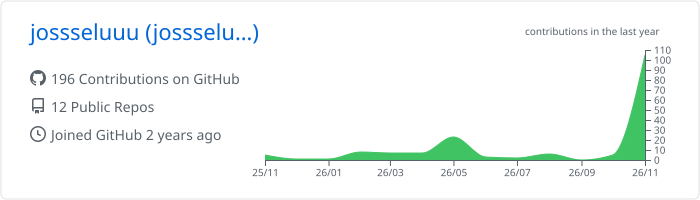
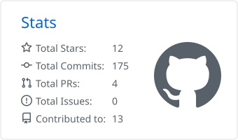
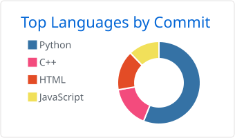

<picture>
  <source media="(prefers-color-scheme: dark)" srcset="assets/banner-dark.png">
  
</picture>

# José Luis López

**Computer Science & Engineering student · Universidad de Granada, Spain** 
AI air traffic controllers · steganography & metadata forensics · AI tools · simulation · bilingual technical writing

 

**English** · [Español](#es)

---

Most of what's on this profile started with a question I couldn't let go of. How does a controller keep dozens of aircraft apart without anyone noticing? How much can you hide inside a photo before the photo gives you away? What is a phone actually saying over the air while it sits on the table?

I answer those questions by building something, measuring how well it works and writing down what I learned along the way.

## About me

I'm in the final stretch of a **Computer Science & Engineering** degree at the **Universidad de Granada**. I spent a full academic year at the **University of Montana**, studying entirely in English and working on campus, which taught me a lot about landing somewhere unfamiliar and figuring things out quickly. Back in Granada I served as my faculty's **student delegate**: I helped bring the student council back to life, built a team around it and represented my classmates on the faculty's governing bodies.

The areas I keep coming back to are backend systems, applied AI, security and optimisation, and above all the places where they overlap. A few habits show up in almost everything I build:

- **I write the design down first.** Specifications, requirements and architecture decision records (ADRs) come before the code, especially in [CompanyAgentsHQ](https://github.com/jossseluuu/CompanyAgentsHQ) and [I-CPU](https://github.com/jossseluuu/I-CPU).
- **I want numbers, not impressions.** I-CPU runs steganalysis against its own output; every change to the openScope bots is kept or thrown away after dozens of seeded one-hour runs; MetaSleuth was checked against hundreds of real files before its first release.
- **Safety is part of the design.** Approval steps, audit logs, safety shields and strict content policies are there from the first commit, not added later.
- **I like explaining things.** I write technical content in English and Spanish, aiming for something a beginner can follow and an expert won't wince at, and my tools explain themselves too: QuantumZero's README is a small course, and MetaSleuth ships its own guide.

---

## Selected projects

| | Project | What it is | Status |
|:-:|---|---|---|
| 🛫 | **[openScope](#openscope)** | AI air traffic controllers that run a whole airport inside an open-source ATC simulator | 🟢 **Active development** · [playable online](https://jossseluuu.github.io/openScope/) |
| 🔐 | **[I-CPU](#i-cpu)** | Hides encrypted data inside images, then attacks its own output to measure how detectable it is | ✅ **Finished** · v2.0.0 |
| 🔎 | **[MetaSleuth](#metasleuth)** | Shows, verifies and strips the metadata hidden in any file, fully offline | ✅ **Finished** · v1.0.0 |
| ✦ | **[Snap Tutor](#snaptutor)** | Browser extension: snap a study question and Claude explains the answer | 🟢 **Active development** · v1.1.0 |
| ⚛️ | **[QuantumZero](#quantumzero)** | Educational quantum circuit simulator in C++17 with zero dependencies | 🔬 **Ongoing research** · v0.1.0 |
| 🏢 | **[CompanyAgentsHQ](#companyagentshq)** | A company of AI agents you manage from an isometric office | 🟢 **Active development** · v1.0.0 |
| 📡 | **[HowThingsTalk](#howthingstalk)** | How everyday devices really work, one question per article, in Spanish and English | 📰 **New article daily** since 1 Nov 2026 |
| 🚦 | **[ZeroTrace](#zerotrace)** | Daily bilingual cybersecurity newsletter, one concept per edition | 📰 **Daily edition** since 3 Nov 2026 |

Each card below is a two-minute summary. The full story, numbers and documentation live in each repository.

 

### 🛫 [openScope](https://github.com/jossseluuu/openScope) · AI air traffic controllers

     

Bots that act as the controller for an entire airport (arrivals, departures and every conflict in between) using **only the commands a human controller has**, under real ICAO, EASA and FAA separation rules. Fork of <a href="https://github.com/openscope/openscope">openScope</a>; the bots, realism layer, headless simulator and two new airports are mine.

- **Three ways to control:** **Bot A** plans with expert rules and metaheuristics · **Bot B** learns by imitation and reinforcement learning (PPO) · **Bot C** splits the work among specialist agents watched by independent supervisors.
- **Safety first, by construction:** one shared safety shield and a rulebook ranked *safety → separation → procedure → efficiency*.
- **Realistic where it matters:** wake turbulence, terrain and minimum vectoring altitudes, squawk 7700 emergencies, and Madrid-Barajas and Málaga built from the Spanish AIP.

**Bot A today** (30 one-hour runs across five airport setups): `0 collisions` · `~16 landings/h` · `~18 departures/h` · `−81% separation losses in one month`

**Status:** 🟢 Active development. Next up: training Bot B, making Bot C's agents fully independent and closing the last separation losses. · **[Play it](https://jossseluuu.github.io/openScope/)** (type `bot a` or `bot c`) · **[Explore the repo →](https://github.com/jossseluuu/openScope)**

 

### 🔐 [I-CPU](https://github.com/jossseluuu/I-CPU) · Hide data in images, then try to find it

    

Most steganography tools stop at hiding. I-CPU hides an encrypted message or file inside an image **and then attacks its own result** with standard steganalysis, so you compare settings by numbers instead of guesses.

- **PNG, JPEG and GIF:** pixel bits, JPEG coefficients without recompressing, and palette indices, animated GIFs included.
- **Hard to spot:** adaptive embedding that changes few samples and prefers textured areas.
- **Hard to read:** Argon2id + XChaCha20-Poly1305, with a random salt in every image.

`3 hiding domains` · `68 tests` · `CI on Windows & Linux` · `CLI + offline web GUI`

**Status:** ✅ Finished, v2.0.0 (November 2026). · **[Explore the repo →](https://github.com/jossseluuu/I-CPU)**

 

### 🔎 [MetaSleuth](https://github.com/jossseluuu/MetaSleuth) · What your files say about you

    

Drop in a photo, a document, a program or a whole folder and MetaSleuth shows what it carries besides its content: where a photo was taken, who wrote a document, whether an image declares it was made by AI. **Nothing leaves your computer.**

- **Finds what matters:** GPS location, editing software, AI-generation traces and hidden text.
- **Verifies, not just reads:** checks C2PA content-credential signatures and says when a file was tampered with.
- **Explains and cleans:** every field is explained, and it can strip GPS or EXIF from a copy before you share.

`35+ formats` · `58 tests on Windows, macOS & Linux` · `checked against 569 real files` · `0 dependencies`

**Status:** ✅ Finished, v1.0.0 (November 2026). · **[Explore the repo →](https://github.com/jossseluuu/MetaSleuth)**

 

### ✦ [Snap Tutor](https://github.com/jossseluuu/extesionBrave) · Study questions, explained

    

Press ✦ (or <kbd>Alt</kbd>+<kbd>Shift</kbd>+<kbd>S</kbd>) on a practice question and, a few seconds later, the right answer appears in the corner **with a short explanation of why**. Unofficial personal project, not affiliated with Anthropic.

- **Your choice of connection:** your own API key, or your Claude account through a small local bridge that can also use your own notes.
- **Private by default:** it captures the visible tab only when you press the button.
- **Made for learning:** built for revision, explicitly not for exams.

`Brave · Chrome · Edge` · `unit + end-to-end tests` · `CI and automatic releases`

**Status:** 🟢 Active development on v1.1.0: bringing it to more browsers, improving the implementation and adding customisation. · **[Explore the repo →](https://github.com/jossseluuu/extesionBrave)**

 

### ⚛️ [QuantumZero](https://github.com/jossseluuu/QuantumZero) · A quantum computer you can read line by line

   

A state-vector simulator that keeps every amplitude of `n` qubits in memory and applies gates directly to it. Build Bell and GHZ states or your own circuit, and **watch superposition, interference and entanglement happen in the numbers**.

- **A README that teaches:** quantum basics in five minutes and a Bell state worked out step by step.
- **Tested from the maths up:** gate identities, the full CNOT truth table and exact amplitudes.

`H · X · Y · Z · CNOT` · `133 checks` · `CI on Windows, Linux & macOS` · `0 dependencies`

**Status:** 🔬 Ongoing research, v0.1.0: exploring how to take it further. · **[Explore the repo →](https://github.com/jossseluuu/QuantumZero)**

 

### 🏢 [CompanyAgentsHQ](https://github.com/jossseluuu/CompanyAgentsHQ) · A company of AI agents you can actually manage

     

Multi-agent systems are usually black boxes. Here you give a goal to the CEO agent, approve its plan, and **watch the team work across an isometric office** while every action is audited and costed.

- **A real org chart:** managers review their team's work, and sensitive actions wait in your approval inbox.
- **Accountable by design:** a verifiable hash-chained audit log, an Auditor agent that stops loops and daily AI budgets.
- **Free to run:** local models through Ollama, any OpenAI-compatible server, or the Claude API with your own key.

`8 starting agents` · `646 roles to hire` · `161 + 66 tracked requirements` · `tested end-to-end on an 8 GB laptop GPU`

**Status:** 🟢 Active development, v1.0.0: improving each agent on its own and the company as a whole. · **[Explore the repo →](https://github.com/jossseluuu/CompanyAgentsHQ)** (source available, all rights reserved)

 

### 📡 [HowThingsTalk](https://github.com/jossseluuu/HowThingsTalk) · How everyday devices actually work

  

One concrete question per article about the tech we use without thinking, such as [how GPS computes your position](https://github.com/jossseluuu/HowThingsTalk/blob/main/docs/EN/05_Positioning/01-HowGPSComputesYourPosition.md) or [what your ISP sees despite HTTPS](https://github.com/jossseluuu/HowThingsTalk/blob/main/docs/EN/11_PrivacyAndFootprint/02-WhatYourISPSeesDespiteHTTPS.md). Clear enough for a beginner, rigorous enough for an expert.

- **Read as deep as you like:** a one-sentence answer, an everyday analogy and where it breaks, then the real mechanism with numbers.
- **Written twice, not translated once:** every article exists in Spanish and English.
- **Timeless on purpose:** no news, reviews or buying advice.

**Status:** 📰 A new article every day since 1 November 2026. · **[Start reading →](https://github.com/jossseluuu/HowThingsTalk)**

 

### 🚦 [ZeroTrace](https://github.com/jossseluuu/ZeroTrace) · Practical cybersecurity, one concept a day

  

Cybersecurity for everyone about the devices people actually use: what a thief can do with your phone after watching you type the passcode, why the cloud isn't a backup, or what a smartwatch without a passcode shows to whoever picks it up.

- **Two reading levels:** *Basic* in a few minutes, *Deep dive* for the technical reader.
- **Right-sized advice:** impact and effort for every action, and what you **don't** need to do.
- **Sources or it didn't happen:** every fact and CVE links to a primary source, and the pages carry no cookies, trackers or third-party scripts.

**Status:** 📰 A new edition every day since 3 November 2026. · **[Read it](https://jossseluuu.github.io/ZeroTrace/en/)** · **[en español](https://jossseluuu.github.io/ZeroTrace/es/)** · **[RSS](https://jossseluuu.github.io/ZeroTrace/en/feed.xml)**

---

### 🧩 Other projects

| Project | What it is | Stack |
|---|---|---|
| 🧮 **[DataStructures-Algorithms](https://github.com/jossseluuu/DataStructures-Algorithms)** | Twenty-one classic data structures written from scratch (lists, stacks, queues, BST, AVL, heaps, trie, hash tables, sets, graphs, union-find) plus searching, six sorting algorithms, Dijkstra, Prim and Kruskal. Each has its own automatic test, with generic template versions and complexity tables. | C++ · CMake |
| ✈️ **[airbaseQueue](https://github.com/jossseluuu/airbaseQueue)** | Discrete-event simulation of the ground-phase sortie cycle at a fighter base (runway, fuel, hangar inspection, maintenance). 30 Monte Carlo replications per scenario with 95% confidence intervals, validated against Erlang-C and Little's law; it finds maintenance, not runway slots, to be the bottleneck. Streamlit dashboard and 38 tests. | Python · SimPy · Streamlit |
| 🎞️ **[AlgorithmVisualizer](https://github.com/jossseluuu/AlgorithmVisualizer)** | Step-by-step animations of seven sorting algorithms, two searches, four pathfinders (BFS, DFS, Dijkstra, A*) and five data structures. The backend runs each algorithm once and returns every snapshot, so the canvas replays them frame by frame at any speed. | Flask · React · Vite · Canvas |
| 📈 **[InvestDashboard](https://github.com/jossseluuu/InvestDashboard)** | A personal portfolio dashboard: live prices converted into seven currencies, per-asset fundamentals and news, P&L charts, and an optional weekly Telegram summary. Includes a Railway + Vercel deployment guide. | Flask · React · SQLite · Chart.js |
| ✈️ **[airline-database-project](https://github.com/jossseluuu/airline-database-project)** | Relational database design for airline operations (pilots, crew, flights, flight plans, aircraft, hangars and maintenance), with a work breakdown structure, a data-quality risk analysis and a small web front end. | MySQL · Flask · JavaScript |

---

## Tech stack

Technologies I've used in the projects above.

| Area | Tools |
|---|---|
| **Languages** |      |
| **Backend & data** |         |
| **Frontend** |        Browser extensions (Manifest V3) · Tkinter desktop apps |
| **AI & ML** |       Reinforcement learning (PPO, DAgger) · metaheuristics (CMA-ES, simulated annealing) · multi-agent supervision · RAG and embeddings · LLM agents and tool use · discrete-event simulation (SimPy) and queueing theory · quantum state-vector simulation |
| **Security** | Applied cryptography (Argon2id, XChaCha20-Poly1305) · steganography and steganalysis · metadata forensics and C2PA verification · fuzzing and sanitizers · Content Security Policy · prompt-injection-aware agent design |
| **Tooling & quality** |         |

Also used in my degree and coursework: C, Java, PHP, Bash, Django, Oracle, Power BI, Tableau and Figma; Azure AI services and Microsoft Defender XDR through Microsoft Learn; and security tools such as Wireshark, Nmap, Burp Suite and Kali Linux.

---

## GitHub activity

<picture>
  <source media="(prefers-color-scheme: dark)" srcset="./profile-summary-card-output/github_dark/0-profile-details.svg">
  
</picture>

<picture>
  <source media="(prefers-color-scheme: dark)" srcset="./profile-summary-card-output/github_dark/3-stats.svg">
  
</picture>
<picture>
  <source media="(prefers-color-scheme: dark)" srcset="./profile-summary-card-output/github_dark/2-most-commit-language.svg">
  
</picture>

<picture>
  <source media="(prefers-color-scheme: dark)" srcset="https://raw.githubusercontent.com/jossseluuu/jossseluuu/output/github-snake-dark.svg">
  
</picture>

---

## 🇪🇸 En español

<b>Leer el perfil completo en español</b>

 

Casi todo lo que hay en este perfil empezó con una pregunta que no me podía quitar de la cabeza. ¿Cómo mantiene un controlador separados a decenas de aviones sin que nadie lo note? ¿Cuánto se puede esconder dentro de una foto antes de que la propia foto te delate? ¿Qué está diciendo exactamente un móvil por el aire mientras descansa sobre la mesa?

Mi forma de responderlas es construir algo, medir qué tal funciona y dejar por escrito lo que aprendo por el camino.

### Sobre mí

Estoy en la recta final de **Ingeniería Informática** en la **Universidad de Granada**. Pasé un curso académico completo en la **University of Montana**, estudiando íntegramente en inglés y trabajando en el campus, algo que me enseñó mucho sobre llegar a un sitio desconocido y espabilarse rápido. En Granada fui **delegado de estudiantes** de mi facultad: ayudé a reactivar la Delegación, formé un equipo para sacarla adelante y representé a mis compañeros en los órganos de gobierno del centro.

Las áreas a las que siempre vuelvo son los sistemas backend, la IA aplicada, la seguridad y la optimización, y sobre todo los puntos donde se cruzan. Hay costumbres que se repiten en casi todo lo que hago:

- **Primero escribo el diseño.** Especificación, requisitos y registros de decisiones de arquitectura (ADR) antes del código, sobre todo en [CompanyAgentsHQ](https://github.com/jossseluuu/CompanyAgentsHQ) e [I-CPU](https://github.com/jossseluuu/I-CPU).
- **Quiero cifras, no impresiones.** I-CPU somete su propio resultado a estegoanálisis; cada cambio en los bots de openScope se queda o se descarta tras decenas de partidas de una hora con semilla; MetaSleuth se contrastó con cientos de archivos reales antes de su primera versión.
- **La seguridad forma parte del diseño.** Aprobaciones, registros de auditoría, escudos de seguridad y políticas de contenido estrictas están desde el primer commit, no se añaden después.
- **Me gusta explicar.** Escribo contenido técnico en español y en inglés, buscando que un principiante pueda seguirlo y que un experto no encuentre nada que corregir, y mis herramientas también se explican solas: el README de QuantumZero es un pequeño curso y MetaSleuth trae su propia guía.

### Proyectos seleccionados

| | Proyecto | Qué es | Estado |
|:-:|---|---|---|
| 🛫 | **[openScope](https://github.com/jossseluuu/openScope)** | Controladores aéreos con IA que llevan un aeropuerto entero en un simulador ATC de código abierto | 🟢 **En desarrollo** · [jugable en línea](https://jossseluuu.github.io/openScope/) |
| 🔐 | **[I-CPU](https://github.com/jossseluuu/I-CPU)** | Esconde datos cifrados en imágenes y después ataca su propio resultado para medir lo detectable que es | ✅ **Finalizado** · v2.0.0 |
| 🔎 | **[MetaSleuth](https://github.com/jossseluuu/MetaSleuth)** | Muestra, verifica y limpia los metadatos ocultos de cualquier archivo, sin conexión | ✅ **Finalizado** · v1.0.0 |
| ✦ | **[Snap Tutor](https://github.com/jossseluuu/extesionBrave)** | Extensión de navegador: capturas una pregunta de estudio y Claude explica la respuesta | 🟢 **En desarrollo** · v1.1.0 |
| ⚛️ | **[QuantumZero](https://github.com/jossseluuu/QuantumZero)** | Simulador educativo de circuitos cuánticos en C++17, sin dependencias | 🔬 **En investigación** · v0.1.0 |
| 🏢 | **[CompanyAgentsHQ](https://github.com/jossseluuu/CompanyAgentsHQ)** | Una empresa de agentes de IA que gestionas desde una oficina isométrica | 🟢 **En desarrollo** · v1.0.0 |
| 📡 | **[HowThingsTalk](https://github.com/jossseluuu/HowThingsTalk)** | Cómo funcionan de verdad los aparatos cotidianos, una pregunta por artículo, en español e inglés | 📰 **Un artículo al día** desde el 1 nov 2026 |
| 🚦 | **[ZeroTrace](https://github.com/jossseluuu/ZeroTrace)** | Boletín diario y bilingüe de ciberseguridad, un concepto por edición | 📰 **Edición diaria** desde el 3 nov 2026 |

Cada ficha es un resumen de dos minutos. La historia completa, las cifras y la documentación están en cada repositorio.

#### 🛫 openScope · Controladores aéreos con IA

Bots que hacen de controlador de todo un aeropuerto (llegadas, salidas y cada conflicto entre ellas) usando **solo las órdenes que tiene un controlador humano**, bajo las normas reales de OACI, EASA y FAA. Fork de <a href="https://github.com/openscope/openscope">openScope</a>; los bots, la capa de realismo, el simulador sin navegador y los dos aeropuertos nuevos son míos.

- **Tres formas de controlar:** el **Bot A** planifica con reglas expertas y metaheurísticas · el **Bot B** aprende por imitación y refuerzo (PPO) · el **Bot C** reparte el trabajo entre agentes especialistas vigilados por supervisores independientes.
- **La seguridad primero, por diseño:** un escudo de seguridad común y un reglamento ordenado como *seguridad → separación → procedimiento → eficiencia*.
- **Realista donde importa:** estela turbulenta, terreno y altitudes mínimas de vectores, emergencias 7700, y Madrid-Barajas y Málaga hechos a partir del AIP España.

**El Bot A hoy** (30 partidas de una hora en cinco configuraciones de aeropuerto): `0 colisiones` · `~16 aterrizajes/h` · `~18 despegues/h` · `−81 % de pérdidas de separación en un mes`

**Estado:** 🟢 En desarrollo. Lo siguiente: entrenar al Bot B, hacer del todo independientes a los agentes del Bot C y cerrar las últimas pérdidas de separación. · **[Juégalo](https://jossseluuu.github.io/openScope/)** (escribe `bot a` o `bot c`) · **[Ver el repo →](https://github.com/jossseluuu/openScope)**

#### 🔐 I-CPU · Esconder datos en imágenes y después intentar encontrarlos

La mayoría de herramientas de esteganografía se quedan en esconder. I-CPU oculta un mensaje o un fichero cifrado dentro de una imagen **y después ataca su propio resultado** con estegoanálisis estándar, para comparar ajustes con números y no a ojo.

- **PNG, JPEG y GIF:** bits de los píxeles, coeficientes de JPEG sin recomprimir e índices de paleta, GIF animados incluidos.
- **Difícil de detectar:** inserción adaptativa que cambia pocas muestras y prefiere las zonas con textura.
- **Difícil de leer:** Argon2id + XChaCha20-Poly1305, con una sal aleatoria en cada imagen.

`3 dominios de ocultación` · `68 pruebas` · `CI en Windows y Linux` · `CLI + GUI web sin conexión`

**Estado:** ✅ Finalizado, v2.0.0 (noviembre de 2026). · **[Ver el repo →](https://github.com/jossseluuu/I-CPU)**

#### 🔎 MetaSleuth · Lo que tus archivos dicen de ti

Le das una foto, un documento, un programa o una carpeta entera y MetaSleuth te enseña lo que lleva además de su contenido: dónde se hizo una foto, quién escribió un documento o si una imagen declara que la generó una IA. **Nada sale de tu ordenador.**

- **Encuentra lo importante:** ubicación GPS, programas de edición, huellas de IA generativa y texto oculto.
- **Verifica, no solo lee:** comprueba las firmas de las credenciales de contenido C2PA y avisa si el archivo se ha manipulado.
- **Explica y limpia:** cada campo viene explicado, y puede quitar el GPS o el EXIF de una copia antes de compartirla.

`35+ formatos` · `58 pruebas en Windows, macOS y Linux` · `contrastado con 569 archivos reales` · `0 dependencias`

**Estado:** ✅ Finalizado, v1.0.0 (noviembre de 2026). · **[Ver el repo →](https://github.com/jossseluuu/MetaSleuth)**

#### ✦ Snap Tutor · Preguntas de estudio, explicadas

Pulsas ✦ (o <kbd>Alt</kbd>+<kbd>Shift</kbd>+<kbd>S</kbd>) sobre una pregunta de práctica y, en unos segundos, aparece en la esquina la respuesta correcta **con una explicación breve del porqué**. Proyecto personal no oficial, sin relación con Anthropic.

- **Tú eliges cómo conectar:** con tu propia API key o con tu cuenta de Claude a través de un pequeño servidor local que además puede usar tus apuntes.
- **Privada por defecto:** solo captura la pestaña visible cuando pulsas el botón.
- **Pensada para aprender:** para repasar, y expresamente no para exámenes.

`Brave · Chrome · Edge` · `pruebas unitarias y de extremo a extremo` · `CI y versiones automáticas`

**Estado:** 🟢 En desarrollo sobre la v1.1.0: llevarla a más navegadores, mejorar la implementación y añadir personalización. · **[Ver el repo →](https://github.com/jossseluuu/extesionBrave)**

#### ⚛️ QuantumZero · Un ordenador cuántico que se lee línea a línea

Un simulador de vector de estado que guarda en memoria todas las amplitudes de `n` qubits y aplica las puertas directamente sobre ellas. Monta estados de Bell y GHZ o tu propio circuito y **mira cómo la superposición, la interferencia y el entrelazamiento aparecen en los números**.

- **Un README que enseña:** fundamentos cuánticos en cinco minutos y un estado de Bell resuelto paso a paso.
- **Probado desde las matemáticas:** identidades de puertas, tabla de verdad completa de CNOT y amplitudes exactas.

`H · X · Y · Z · CNOT` · `133 comprobaciones` · `CI en Windows, Linux y macOS` · `0 dependencias`

**Estado:** 🔬 En investigación, v0.1.0: estudiando cómo llevarlo más lejos. · **[Ver el repo →](https://github.com/jossseluuu/QuantumZero)**

#### 🏢 CompanyAgentsHQ · Una empresa de agentes de IA que de verdad puedes gestionar

Los sistemas multiagente suelen ser cajas negras. Aquí das un objetivo a la CEO, apruebas su plan y **ves al equipo trabajar por una oficina isométrica** mientras cada acción queda auditada y con su coste.

- **Un organigrama real:** los jefes revisan el trabajo de su equipo y las acciones delicadas esperan en tu bandeja de aprobaciones.
- **Responsable por diseño:** registro de auditoría encadenado y verificable, un agente Auditor que corta los bucles y presupuestos diarios de IA.
- **Gratis de usar:** modelos locales con Ollama, cualquier servidor compatible con OpenAI o la API de Claude con tu clave.

`8 agentes de inicio` · `646 cargos para contratar` · `161 + 66 requisitos con seguimiento` · `probado de principio a fin en una GPU de portátil de 8 GB`

**Estado:** 🟢 En desarrollo, v1.0.0: mejorando cada agente por separado y la empresa en su conjunto. · **[Ver el repo →](https://github.com/jossseluuu/CompanyAgentsHQ)** (código visible, todos los derechos reservados)

#### 📡 HowThingsTalk · Cómo funcionan de verdad los aparatos cotidianos

Una pregunta concreta por artículo sobre la tecnología que usamos sin pensar, como [cómo calcula el GPS tu posición](https://github.com/jossseluuu/HowThingsTalk/blob/main/docs/ES/05_Geolocalizacion/01-ComoCalculaElGPSTuPosicion.md) o [por qué los móviles cambian su dirección MAC](https://github.com/jossseluuu/HowThingsTalk/blob/main/docs/ES/11_PrivacidadYHuella/01-PorQueElMovilCambiaSuDireccionMAC.md). Claro para un principiante, riguroso para un experto.

- **Lees hasta donde quieras:** una respuesta de una frase, una analogía cotidiana y dónde falla, y después el mecanismo real con números.
- **Escrito dos veces, no traducido una:** cada artículo existe en español y en inglés.
- **Atemporal a propósito:** sin noticias, reseñas ni recomendaciones de compra.

**Estado:** 📰 Un artículo nuevo cada día desde el 1 de noviembre de 2026. · **[Empieza a leer →](https://github.com/jossseluuu/HowThingsTalk)**

#### 🚦 ZeroTrace · Ciberseguridad útil, un concepto al día

Ciberseguridad para todos sobre los dispositivos que usamos de verdad: qué puede hacer quien te roba el móvil después de verte teclear el código, por qué la nube no es una copia de seguridad o qué enseña un reloj sin código a quien lo coja.

- **Dos niveles de lectura:** *Básico* en pocos minutos y *A fondo* para perfiles técnicos.
- **Medidas en su justa medida:** impacto y esfuerzo de cada medida, y lo que **no** hace falta hacer.
- **Sin fuente no hay dato:** cada dato y cada CVE enlazan a una fuente primaria, y las páginas no llevan cookies, rastreadores ni scripts de terceros.

**Estado:** 📰 Una edición nueva cada día desde el 3 de noviembre de 2026. · **[Léelo](https://jossseluuu.github.io/ZeroTrace/es/)** · **[in English](https://jossseluuu.github.io/ZeroTrace/en/)** · **[RSS](https://jossseluuu.github.io/ZeroTrace/es/feed.xml)**

### 🧩 Otros proyectos

| Proyecto | Qué es | Stack |
|---|---|---|
| 🧮 **[DataStructures-Algorithms](https://github.com/jossseluuu/DataStructures-Algorithms)** | Veintiuna estructuras de datos clásicas escritas desde cero (listas, pilas, colas, ABB, AVL, montículos, trie, tablas hash, conjuntos, grafos, union-find), además de búsqueda, seis algoritmos de ordenación, Dijkstra, Prim y Kruskal. Cada una con su prueba automática, versiones genéricas con plantillas y tablas de complejidad. | C++ · CMake |
| ✈️ **[airbaseQueue](https://github.com/jossseluuu/airbaseQueue)** | Simulación de eventos discretos del ciclo de salidas en tierra de una base de cazas (pista, combustible, inspección en hangar, mantenimiento). 30 réplicas Monte Carlo por escenario con intervalos de confianza al 95 %, validada con Erlang-C y la ley de Little; concluye que el cuello de botella es el mantenimiento, no la pista. Panel en Streamlit y 38 pruebas. | Python · SimPy · Streamlit |
| 🎞️ **[AlgorithmVisualizer](https://github.com/jossseluuu/AlgorithmVisualizer)** | Animaciones paso a paso de siete algoritmos de ordenación, dos búsquedas, cuatro de caminos (BFS, DFS, Dijkstra, A*) y cinco estructuras de datos. El backend ejecuta cada algoritmo una vez y devuelve todas las instantáneas, así que el lienzo las reproduce fotograma a fotograma a cualquier velocidad. | Flask · React · Vite · Canvas |
| 📈 **[InvestDashboard](https://github.com/jossseluuu/InvestDashboard)** | Un panel personal de cartera: precios en vivo convertidos a siete divisas, fundamentales y noticias por activo, gráficas de rentabilidad y un resumen semanal opcional por Telegram. Incluye una guía de despliegue en Railway y Vercel. | Flask · React · SQLite · Chart.js |
| ✈️ **[airline-database-project](https://github.com/jossseluuu/airline-database-project)** | Diseño de una base de datos relacional para la operativa de una aerolínea (pilotos, tripulación, vuelos, planes de vuelo, aeronaves, hangares y mantenimiento), con desglose del trabajo, análisis de riesgos de calidad de datos y una pequeña web. | MySQL · Flask · JavaScript |

### Tecnologías

Las tecnologías de los proyectos anteriores aparecen en la [tabla en inglés](#tech-stack). En la carrera y en cursos también he trabajado con C, Java, PHP, Bash, Django, Oracle, Power BI, Tableau y Figma; con Azure AI y Microsoft Defender XDR a través de Microsoft Learn; y con herramientas de seguridad como Wireshark, Nmap, Burp Suite y Kali Linux.

---

### Let's talk · Hablemos

Working on something in backend, AI or security? I'd be glad to hear about it. 
¿Trabajas en algo de backend, IA o seguridad? Me encantará que me lo cuentes.

