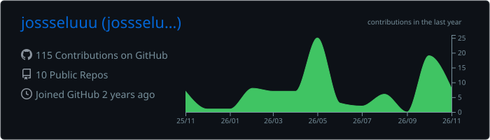
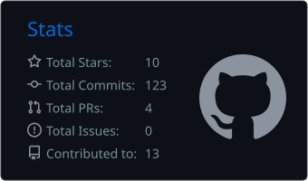
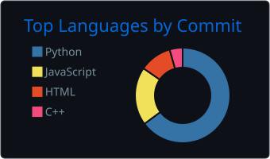

# Hi, I'm José Luis López 👋

  
  
  

<b>EN</b> English · <b>ES</b> <a href="#es">Versión en español</a>

---

## 👨‍💻 About Me

I'm a **final-year Computer Science & Engineering student** at the **Universidad de Granada (UGR)**, Spain.

I spent a **full academic year at the University of Montana (USA)** through an international mobility program, where I also **worked in the United States**. That year taught me to study, work and solve problems in English, inside teams with very different backgrounds and ways of working, and made me more independent, adaptable and comfortable with responsibility.

I build software that is **useful, secure and easy to reason about**, and I like to prove what I learn with complete projects: tests, CI, documentation and written architecture decisions included.

**What I'm working on**

- 🏢 **[AgentHQ](https://github.com/jossseluuu/CompanyAgentsHQ)**: a company run by AI agents that you manage from a live isometric office.
- 🔐 **[I-CPU](https://github.com/jossseluuu/I-CPU)**: encrypted steganography in modern C++, with built-in steganalysis.
- 📡 **[HowThingsTalk](https://github.com/jossseluuu/HowThingsTalk)**: a bilingual library on how everyday devices really work, with **a new article every weekday**.
- 🛫 **[openScope](https://github.com/jossseluuu/openScope)**: my own version of an open-source air traffic control simulator.

**What I bring**

- ⚙️ **Backend & APIs**: Python (FastAPI, Flask, Django), Node.js, PostgreSQL, Redis, WebSockets
- 🤖 **Applied AI**: LLM agents, tool use, RAG with pgvector, with cost and safety controls built in
- 🛡️ **Security by design**: applied cryptography, least privilege, prompt-injection defences, tamper-evident audit logs
- 🧪 **Engineering discipline**: automated tests, CI, ADRs and Docker setups that start with a single command
- 🗣️ **Clear communication**: I write technical documentation and explanations in English and Spanish

**Where I fit best**

I do my best work in teams that build **backend systems, AI products or security tooling** and care about engineering quality. I'm used to working in English and Spanish, in international environments, remotely or on-site.

---

## 🚀 Featured Projects

### 🏢 [AgentHQ](https://github.com/jossseluuu/CompanyAgentsHQ) · AI agents as a real company
Personal project · 🚧 in active development

**The problem.** Multi-agent AI systems are usually black boxes: they're configured in code, followed through logs, and it's hard to tell who did what, where each document ended up and how much it cost.

**The idea.** AgentHQ turns them into a company you can see. You give a goal to the **CEO agent**, who plans it and delegates it to departments (marketing, tech, finance…). Each department's head reviews its team's work before it reaches you, and everything produced ends up archived and searchable. All of it happens in a **2.5D isometric office** where agents walk between rooms according to what they're doing.

- **Real org chart**: 8 agents with managers, supervisors, escalation rules and an **approval inbox** for sensitive actions
- **RAG knowledge bases** scoped to the company, a department, a room or a single agent, with source citations
- **Append-only, hash-chained audit log** plus an independent **Auditor agent** that flags anomalies and can pause other agents
- **Cost control**: per-agent budgets and a daily AI spending cap that stops work when it's reached
- **Modular monolith**: each room module (file cabinet, finance dashboard, rest area…) is a plugin; agent work runs in a separate worker over Redis and streams to the browser via WebSockets
- **Swappable LLM provider** behind its own interface (Claude, OpenAI or local models via Ollama)

        

---

### 🔐 [I-CPU](https://github.com/jossseluuu/I-CPU) · Encrypted steganography
Applied cryptography · C++20

**What it does.** Hides a text or a whole file inside an image so that, **without the password, it can't be read or even proven to exist**.

**How it works.** It chooses the hiding technique based on the output format, encrypts everything before writing it, and then measures how detectable the result is, so you can compare configurations with real numbers instead of guessing.

- **Three hiding domains**: least significant bits of pixels (PNG, BMP, TGA…), **DCT coefficients** in JPEG without recompressing the image, and **palette indices** in GIF, including animated ones
- **Modern cryptography**: Argon2id key derivation + XChaCha20-Poly1305 authenticated encryption; the embedding positions come from the password and even the **header is encrypted**, so nothing recognisable is left in the image
- **Built-in steganalysis** (chi-square, RS analysis, DCT chi-square) and **distortion metrics** (PSNR, SSIM)
- **Two interfaces**: a CLI with a guided mode and an **offline local web GUI** with before/after comparison and a live capacity meter
- **Engineering**: CMake presets, automated tests, CI and architecture decision records (ADRs)

   

---

### 📡 [HowThingsTalk](https://github.com/jossseluuu/HowThingsTalk) · How everyday devices really work
Technical writing · ES / EN · new article every weekday

**What it is.** A growing library that explains **how the devices we use every day work underneath**: phones, laptops, earbuds, watches, speakers, cards, light bulbs and cars. Each article answers **one concrete question**, in Spanish and English.

**How it's written.** Every article is built in **four layers of depth**, so a beginner can stop early with the core idea and an expert can go all the way down:

1. **The question and the depth** it requires
2. **The short answer**, in one sentence plus a 60-second summary
3. **The mental model**: an everyday analogy, and exactly where it breaks
4. **The technical mechanism**: flow diagrams, data frames, protocols, radio spectrum and the real physical numbers

It's timeless on purpose: no news, no reviews, no buying advice. What's explained here should still hold in five years.

  

---

### 📈 [InvestDashboard](https://github.com/jossseluuu/InvestDashboard) · Personal investment dashboard
Full-stack · Flask + React

**What it does.** Tracks an investment portfolio in one place: holdings, real-time prices, performance over time and market news.

- **Real-time prices** and **multi-currency** support (USD, EUR, GBP, JPY…) with live exchange rates and a fallback provider
- **Charts**: portfolio value and P&L over time, per-ticker price history and allocation
- **Market data per asset**: fundamentals, analyst ratings and price targets, earnings calendar with EPS surprises, dividend history and company news
- **Background jobs** with APScheduler, CSV import/export, dark mode and optional **weekly Telegram alerts**
- **Deployment-ready**: backend on Railway and frontend on Vercel

     

---

### 🛫 [openScope](https://github.com/jossseluuu/openScope) · Air traffic control simulator
Open source · JavaScript

**What it is.** My own version of **openScope**, a browser-based air traffic control simulator where you guide real traffic around real airports.

**Why I work on it.** It brings together aviation, one of my long-standing interests, and the challenge of understanding and extending a **large, real-world codebase** written by many contributors: its simulation logic, airport data files, Node-based build tooling, tests and a GitFlow workflow.

  

---

More: 🧮 <a href="https://github.com/jossseluuu/DataStructures-Algorithms">DataStructures-Algorithms</a> (data structures from scratch in C++, with tests) · ✈️ <a href="https://github.com/jossseluuu/airline-database-project">airline-database-project</a> (relational model for airline operations: pilots, crews, flights, aircraft, maintenance)

---

## 🛠️ Tech Stack

| Area | Technologies |
|---|---|
| **Languages** |           |
| **Backend** |           |
| **Frontend** |         |
| **Data** |       |
| **AI / LLMs** |              |
| **Security** |    -000000?style=flat-square)        |
| **DevOps & Quality** |          |

---

## 📊 GitHub Stats

---

## 🌐 Versión en español (ES)

<b>Haz clic para leer mi perfil completo en español</b>

 

### 👨‍💻 Sobre mí

Soy **estudiante de último curso de Ingeniería Informática** en la **Universidad de Granada (UGR)**.

Pasé **un curso académico completo en la University of Montana (EE. UU.)** gracias a un programa de movilidad internacional, donde además **trabajé en Estados Unidos**. Ese año me enseñó a estudiar, trabajar y resolver problemas en inglés, dentro de equipos con orígenes y formas de trabajar muy distintas, y me hizo más autónomo, adaptable y acostumbrado a asumir responsabilidades.

Construyo software **útil, seguro y fácil de razonar**, y me gusta demostrar lo que aprendo con proyectos completos: con tests, integración continua, documentación y decisiones de arquitectura por escrito.

**En qué estoy trabajando**

- 🏢 **[AgentHQ](https://github.com/jossseluuu/CompanyAgentsHQ)**: una empresa formada por agentes de IA que diriges desde una oficina isométrica en tiempo real.
- 🔐 **[I-CPU](https://github.com/jossseluuu/I-CPU)**: esteganografía cifrada en C++ moderno, con estegoanálisis integrado.
- 📡 **[HowThingsTalk](https://github.com/jossseluuu/HowThingsTalk)**: una biblioteca bilingüe sobre cómo funcionan de verdad los aparatos del día a día, con **un artículo nuevo cada día laborable**.
- 🛫 **[openScope](https://github.com/jossseluuu/openScope)**: mi propia versión de un simulador de control de tráfico aéreo de código abierto.

**Qué aporto**

- ⚙️ **Backend y APIs**: Python (FastAPI, Flask, Django), Node.js, PostgreSQL, Redis, WebSockets
- 🤖 **IA aplicada**: agentes con LLMs, uso de herramientas, RAG con pgvector, con control de costes y de seguridad desde el diseño
- 🛡️ **Seguridad desde el diseño**: criptografía aplicada, mínimo privilegio, defensa ante *prompt injection*, registros de auditoría a prueba de manipulaciones
- 🧪 **Rigor de ingeniería**: tests automatizados, CI, ADRs y entornos con Docker que arrancan con un solo comando
- 🗣️ **Comunicación clara**: escribo documentación y divulgación técnica en español y en inglés

**Dónde encajo mejor**

Rindo al máximo en equipos que construyen **sistemas backend, productos de IA o herramientas de seguridad** y que cuidan la calidad de la ingeniería. Estoy acostumbrado a trabajar en español y en inglés, en entornos internacionales, en remoto o presencial.

### 🚀 Proyectos destacados

**🏢 [AgentHQ](https://github.com/jossseluuu/CompanyAgentsHQ) · Agentes de IA como una empresa real** · proyecto personal en desarrollo

Los sistemas multiagente suelen ser cajas negras: se configuran en código, se siguen leyendo logs y es difícil saber quién hizo qué, dónde está cada documento y cuánto ha costado. AgentHQ los convierte en una empresa visible: das un objetivo al **agente CEO**, que lo planifica y lo reparte entre departamentos; cada jefe revisa el trabajo de su equipo antes de que llegue a ti, y todo queda archivado y es buscable, en una **oficina isométrica 2.5D** por la que los agentes se mueven según lo que hacen.

- **Organigrama real**: 8 agentes con jefes, supervisores, escalado y **bandeja de aprobaciones** para acciones sensibles
- **Bases de conocimiento RAG** por empresa, departamento, sala o agente, con citas de las fuentes
- **Registro de auditoría encadenado con hashes** y un **agente Auditor** independiente que detecta anomalías y puede pausar agentes
- **Control de costes**: presupuesto por agente y límite diario de gasto en IA
- **Monolito modular** con módulos de sala como plugins, worker separado sobre Redis y eventos en tiempo real por WebSocket
- **Proveedor de LLM intercambiable** (Claude, OpenAI o modelos locales con Ollama)

*FastAPI · React + TypeScript · React Three Fiber · PostgreSQL + pgvector · Redis · Claude API · Docker*

**🔐 [I-CPU](https://github.com/jossseluuu/I-CPU) · Esteganografía cifrada** · criptografía aplicada · C++20

Oculta un texto o un fichero dentro de una imagen de forma que, **sin la contraseña, no se puede ni leer ni demostrar que existe**. Elige la técnica según el formato de salida, cifra todo antes de escribirlo y mide lo detectable que es el resultado.

- **Tres dominios de ocultación**: bits bajos de los píxeles (PNG, BMP, TGA…), **coeficientes DCT** de JPEG sin recomprimir y **índices de paleta** de GIF, incluidos los animados
- **Criptografía moderna**: Argon2id + XChaCha20-Poly1305; las posiciones salen de la contraseña y hasta la **cabecera va cifrada**
- **Estegoanálisis integrado** (chi-cuadrado, análisis RS, chi-cuadrado DCT) y métricas de distorsión (PSNR, SSIM)
- **CLI con modo guiado** y **GUI web local sin conexión**, con comparador antes/después y medidor de capacidad
- CMake, tests automatizados, CI y ADRs

**📡 [HowThingsTalk](https://github.com/jossseluuu/HowThingsTalk) · Cómo funcionan de verdad los aparatos** · divulgación técnica · ES/EN · un artículo cada día laborable

Biblioteca que explica **cómo funcionan por dentro los aparatos del día a día**: teléfonos, portátiles, auriculares, relojes, altavoces, tarjetas, bombillas y coches. Cada artículo responde a **una pregunta concreta** en **cuatro capas de profundidad**: la pregunta y su nivel, la respuesta corta, el modelo mental (y dónde se rompe la analogía) y el mecanismo técnico, con protocolos, tramas de datos, espectro de radio y números reales. Atemporal a propósito: sin noticias, reseñas ni recomendaciones de compra.

**📈 [InvestDashboard](https://github.com/jossseluuu/InvestDashboard) · Dashboard de inversiones** · full-stack · Flask + React

Seguimiento de una cartera de inversión en un solo sitio: precios en tiempo real, **multidivisa** con tipos de cambio en vivo, evolución de valor y P&L, fundamentales, valoraciones de analistas, calendario de resultados, dividendos y noticias por empresa. Incluye tareas programadas, importación/exportación CSV, modo oscuro, **alertas semanales por Telegram** y despliegue en Railway + Vercel.

**🛫 [openScope](https://github.com/jossseluuu/openScope) · Simulador de control aéreo** · código abierto · JavaScript

Mi versión de **openScope**, un simulador de control de tráfico aéreo en el navegador con tráfico y aeropuertos reales. Une la aviación, uno de mis intereses de siempre, con el reto de entender y ampliar un **código grande y real** escrito por muchos colaboradores: lógica de simulación, datos de aeropuertos, herramientas de build con Node, tests y flujo GitFlow.

Más: 🧮 <a href="https://github.com/jossseluuu/DataStructures-Algorithms">DataStructures-Algorithms</a> (estructuras de datos desde cero en C++, con tests) · ✈️ <a href="https://github.com/jossseluuu/airline-database-project">airline-database-project</a> (modelo relacional para la operativa de una aerolínea)

---

### 📫 Let's talk · Hablemos

Working on something interesting in backend, AI or security? I'd be glad to talk. 
¿Trabajas en algo interesante de backend, IA o seguridad? Estaré encantado de hablar.

